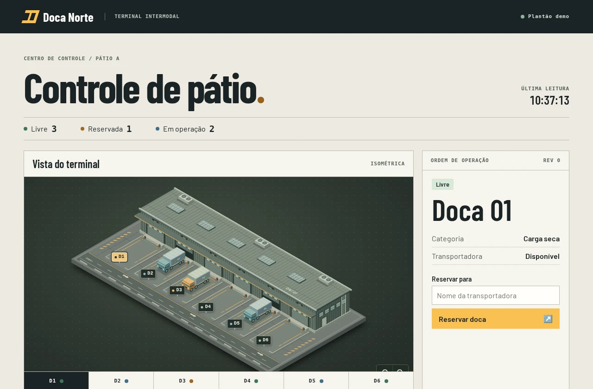

# Victor Almeida

Trabalho com infraestrutura e redes. Em ambiente escolar, cuidei de dispositivos no domínio e da continuidade da conexão com dois links de internet. Estes três projetos levam essa experiência de operação para o desenvolvimento de software.

## Portfólio

| Projeto | Problema de engenharia | Explore |
| --- | --- | --- |
| **Doca Norte** · Java, Angular e Flutter | Dois operadores reservam a mesma doca. A API aceita uma única reserva e atualiza o pátio e a portaria. | [Ver demonstração](portfolio/docs/demonstracoes.md#doca-norte) · [Código e arquitetura](portfolio/doca-norte/) |
| **Lastro** · C#, React e Blazor | Um extrato chega duas vezes ou traz uma referência conflitante. O livro de conciliação precisa conservar os valores e a trilha de auditoria. | [Ver demonstração](portfolio/docs/demonstracoes.md#lastro) · [Código e arquitetura](portfolio/lastro/) |
| **Farol** · Python, busca vetorial e n8n | Um plantonista pergunta quando o link de reserva deve assumir. O assistente mostra o trecho do manual ou encaminha a pergunta para revisão. | [Ver demonstração](portfolio/docs/demonstracoes.md#farol) · [Código e arquitetura](portfolio/farol/) |

[Executar os três aplicativos](portfolio/) · [Conferir os testes](portfolio/docs/verificacao.md) · [Ler o estudo financeiro em inglês](portfolio/docs/lastro-walkthrough.en.md)
