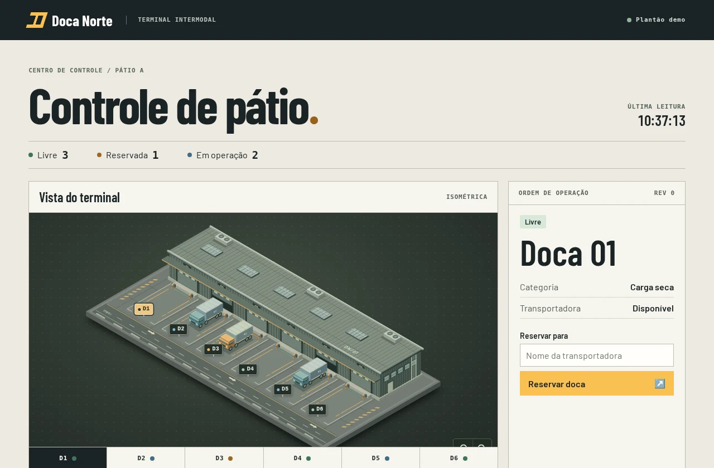

# Doca Norte

[Ver demonstração](../docs/demonstracoes.md#doca-norte) · [Todos os projetos](../../README.md)



Um operador precisa saber onde receber o próximo caminhão. A tela Angular permite selecionar a doca no modelo isométrico, reservar para uma transportadora, iniciar a descarga e registrar a liberação. A portaria e o aplicativo Flutter consultam uma projeção de leitura separada do histórico da operação.

## Demonstrar

1. Na [execução com Compose](../README.md), abra [o pátio](http://localhost:8081) e selecione D1, ou outra posição livre.
2. Informe uma transportadora. Clique em **Reservar doca**, **Iniciar descarga** e **Liberar doca**.
3. Confira a sequência no livro de movimentos. Recarregue a página para confirmar a persistência.
4. Consulte [a portaria](http://localhost:8085/api/field). A projeção é atualizada a cada cinco segundos.

## Contrato e arquitetura

| Entrada | Resultado |
| --- | --- |
| `GET /api/yard` | Seis docas, versão de cada agregado e os quarenta movimentos mais recentes |
| `GET /api/session` | Sessão, permissão de escrita, token CSRF e nome do cabeçalho |
| `POST /api/docks/{id}/moves` | Transição com `action`, `carrier`, `expectedVersion`, cabeçalhos CSRF e `Idempotency-Key` UUID |
| `GET /actuator/health`, `/actuator/prometheus` | Saúde, contadores de movimentos e conflitos |
| `GET /api/field` na portaria | Posição, transportadora, revisão temporal da leitura e indicador de desatualização |

O [contrato OpenAPI 3.1](server/src/main/resources/static/yard-api.json) descreve as rotas principais.

O `Yard.apply` bloqueia a linha com `SELECT FOR UPDATE`, confere a versão do operador e grava o movimento na mesma transação da mudança de estado. Uma repetição idêntica retorna o estado atual da doca. Uma chave reutilizada com outra intenção, ou uma decisão feita sobre uma versão antiga, retorna 409. O medidor de atividade é telemetria de processo. O livro no banco é o registro durável.

A portaria consulta a API central e conserva a última leitura em memória. Após 12 segundos sinaliza defasagem. Após 120 segundos retorna 503. O cliente Flutter marca falha de atualização e permite tentar novamente. O modelo no navegador usa projeção axonométrica de geometria 3D desenhada em Canvas 2D, seleção por teclado e giro de câmera.

## Executar com SDKs

Requisitos: Java 21, Maven 3.9, Node 24. Abra terminais separados na pasta do projeto.

```sh
cd server
mvn spring-boot:run
```

```sh
cd web
npm ci
npm run dev
```

A interface de desenvolvimento abre em `http://localhost:4200`. Em outro terminal execute `mvn -f portaria/pom.xml spring-boot:run`. O modo nativo usa H2 em arquivo. Compose usa PostgreSQL. Configure `JDBC_URL`, `DB_USER` e `DB_PASSWORD` para um banco dedicado.

## Identidade e telemetria

O modo local demonstra a operação do pátio. Para uma equipe autenticada, configure o perfil `oidc` com `SPRING_PROFILES_ACTIVE=oidc`, `OIDC_ISSUER`, `OIDC_CLIENT_ID`, `OIDC_CLIENT_SECRET` e `OIDC_OPERATOR_GROUP`. Registre `https://HOST/login/oauth2/code/yard` como retorno no provedor. O cliente Spring processa o login OIDC por authorization code e valida o ID token do emissor. O grupo no claim `groups` habilita as mudanças. O navegador guarda a sessão HTTP-only. Faça o teste com HTTPS e com usuários dos grupos de leitura e escrita antes de expor dados de operação.

Os logs do servidor incluem ID de requisição, doca, ação e versão. `yard_movements_total` e `yard_conflicts_total` aparecem no Prometheus após os respectivos eventos.

## Verificar

```sh
mvn -f server/pom.xml test
mvn -f portaria/pom.xml test
```

Para executar novamente em PostgreSQL, use uma base **descartável** e configure `TEST_JDBC_URL`, `TEST_DB_USER` e `TEST_DB_PASSWORD`. O setup do teste limpa os movimentos da base escolhida. A suíte cobre a disputa simultânea pela mesma doca, repetição, CSRF, transições, grupo de operador e expiração da leitura. [Aplicativo de campo](field/README.md) · [Gravação do fluxo](../docs/media/doca.mp4)
