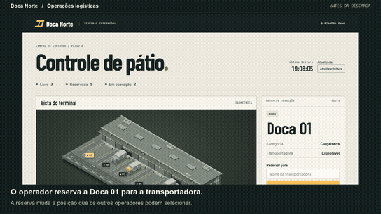
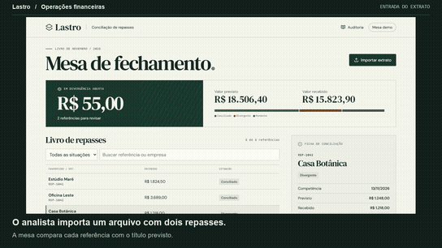
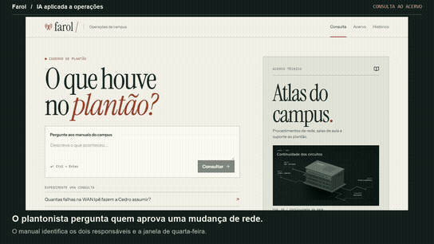

# Demonstrações

As gravações mostram as interfaces operando com as APIs e os bancos de dados de teste. Os dados são fictícios. Cada seção inclui uma prévia animada, o vídeo original e o código correspondente.

## Doca Norte

O operador reserva uma doca, inicia a descarga e libera a posição. A maquete e o histórico acompanham o mesmo movimento.



[Vídeo MP4](media/doca.mp4) · [Legenda em português](media/doca.vtt) · [Tela no celular](media/doca-mobile.webp) · [Código e arquitetura](../doca-norte/)

## Lastro

O analista importa um extrato, encontra uma diferença de R$ 17,50 e registra a justificativa. O livro de auditoria conserva a decisão.



[Vídeo MP4](media/lastro.mp4) · [Legenda em português](media/lastro.vtt) · [English captions](media/lastro.en.vtt) · [Tela no celular](media/lastro-mobile.webp) · [Código e arquitetura](../lastro/)

## Farol

Uma pergunta sobre a queda do link principal leva ao trecho do manual. A pergunta seguinte fica sem evidência e entra na fila de revisão.



[Vídeo MP4](media/farol.mp4) · [Legenda em português](media/farol.vtt) · [Tela no celular](media/farol-mobile.webp) · [Código e arquitetura](../farol/)

## Abrir a mostra interativa localmente

Na pasta `portfolio/` de um clone Git, execute os dois comandos e abra [a mostra](http://localhost:8000).

```sh
python showcase/build.py --out .artifacts/mostra
python -m http.server --directory .artifacts/mostra 8000
```

A mostra inclui a maquete navegável por teclado, os vídeos com legendas e um pacote com o histórico Git. [Execução dos aplicativos e serviços](../README.md)
