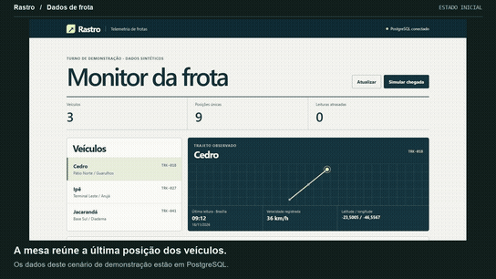

# Demonstrações dos quatro projetos

Cada filme dura 27 segundos. Os controles foram acionados no Chromium com as APIs em execução e dados fictícios. Cada MP4 contém texto na tela e legenda selecionável. A mostra também oferece uma transcrição em HTML.

| Projeto | O que observar | Filme e código |
| --- | --- | --- |
| Doca Norte | Uma posição muda de estado e volta ao pátio livre | [Assistir](media/doca.mp4) · [Código Java e Angular](../doca-norte/) |
| Lastro | Um reenvio preserva o livro e a revisão explica a diferença | [Assistir](media/lastro.mp4) · [Código C# e React](../lastro/) |
| Farol | Uma pergunta abre o manual na seção correta e outra entra na fila | [Assistir](media/farol.mp4) · [Código Python e React](../farol/) |
| Rastro | Uma leitura atrasada entra no histórico e a posição corrente é preservada | [Assistir](media/rastro.mp4) · [PostgreSQL e API](../rastro/) |

## Doca Norte

O operador reserva a Doca 01, inicia a descarga e libera a posição. A sequência termina no livro de movimentos. O [teste de concorrência](../doca-norte/server/src/test/java/br/dev/docanorte/YardTest.java) mostra o caso adicional em que duas pessoas tentam a mesma reserva.

[](media/doca.mp4)

[MP4](media/doca.mp4) · [Legenda PT-BR](media/doca.vtt) · [Painel web em 390 px](media/doca-mobile.webp)

## Lastro

O analista importa dois repasses, reenvia o arquivo e abre a diferença de R$ 17,50 da referência REP-1048. A justificativa aparece na página de auditoria Blazor. O [teste do lote conflitante](../lastro/tests/BookTests.cs) verifica que uma falha reverte o lote inteiro.

[](media/lastro.mp4)

[MP4](media/lastro.mp4) · [Legenda PT-BR](media/lastro.vtt) · [English captions](media/lastro.en.vtt) · [Tela em 390 px](media/lastro-mobile.webp)

## Farol

O plantonista pergunta quem aprova uma mudança e quando ela pode ocorrer. A aplicação mostra a fonte RB-06 e abre o trecho sobre aprovações e horário. Depois, encaminha para revisão uma pergunta de preço que os manuais não cobrem. O filme usa o modo extrativo com o índice local. O [ensaio com Qwen](modelo.md) documenta o perfil com modelo de linguagem.

[](media/farol.mp4)

[MP4](media/farol.mp4) · [Legenda PT-BR](media/farol.vtt) · [Tela em 390 px](media/farol-mobile.webp)

## Rastro

A mesa consulta um banco PostgreSQL com veículos de demonstração. Na primeira chegada, o veículo tem uma posição atualizada, um reenvio reconhecido e uma leitura atrasada. A segunda execução reconhece os três reenvios. A linha do tempo conserva a leitura que chegou tarde.

[](media/rastro.mp4)

[MP4](media/rastro.mp4) · [Legenda PT-BR](media/rastro.vtt) · [Tela em 390 px](media/rastro-mobile.webp) · [Consultas, índices e execução](../rastro/)

## Abrir a mostra localmente

Na pasta `portfolio/` de um clone Git, execute os comandos abaixo e abra [localhost:8000](http://localhost:8000).

```sh
python showcase/build.py --out .artifacts/mostra
python -m http.server --directory .artifacts/mostra 8000
```

A mostra contém as páginas individuais, a maquete de pátio, o currículo para leitura e em texto, as legendas e o pacote com o código e o histórico Git.

## Reproduzir as capturas

Inicie os quatro aplicativos com bases de demonstração descartáveis. Use `RASTRO_DEMO=1` e o cenário ainda sem reenvios no Rastro. A gravação cria movimentos, concilia um extrato e executa o cenário de telemetria. Para reproduzir o filme de cada produto separadamente, acrescente `--only doca`, `--only lastro`, `--only farol` ou `--only rastro` aos dois comandos de produção.

Instale as dependências Playwright em `tests/`, FFmpeg com libx264 e ffprobe, as fontes DejaVu e Pillow. A partir de `portfolio/`, execute o seguinte.

```sh
(cd tests && npm ci && npx playwright install chromium)
python -m pip install pillow
node showcase/capture.mjs --out .artifacts/capturas
python showcase/films.py --input .artifacts/capturas --out docs/media
```

As portas locais padrão são 8081 a 8084. Para outra instalação de testes, as variáveis `DOCA_URL`, `LASTRO_URL`, `FAROL_URL` e `RASTRO_URL` definem a origem de cada aplicação. `CHROMIUM_PATH` permite selecionar um binário de Chromium já instalado.
