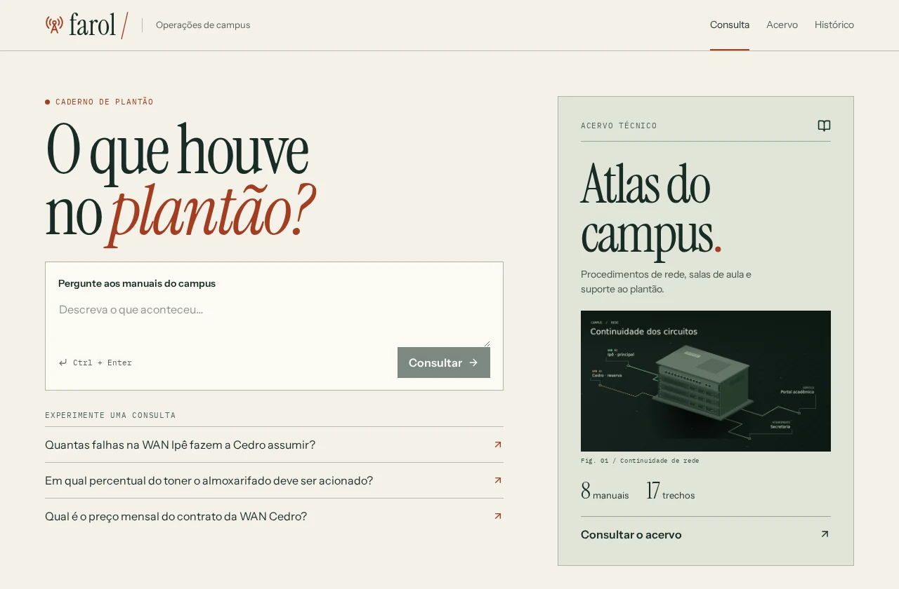

# Farol

[Ver demonstração](../docs/demonstracoes.md#farol) · [Todos os projetos](../../README.md)



Um plantonista precisa saber o que fazer e mostrar de qual procedimento saiu a orientação. O Farol pesquisa **oito manuais fictícios de TI escolar, divididos em 17 seções**. O operador lê a resposta, abre o trecho destacado no manual e vê a revisão do documento. Uma pergunta sem evidência pode seguir para revisão humana.

## Escopo e decisões

O produto atende consultas de plantão sobre rede, impressão, salas, empréstimos, incidentes, mudanças e recuperação de arquivos. O contexto disponível é o acervo aprovado e, quando a pessoa escolhe, um manual específico para a próxima pergunta. O serviço de IA tem acesso de leitura a essas fontes. O encaminhamento de uma revisão depende de uma ação do operador.

O modo padrão roda localmente sem chave de modelo. FastAPI atende a interface React/TypeScript, SQLite-vec ordena os trechos e SQLite guarda o histórico por sessão. O perfil com modelo usa um provedor compatível com Chat Completions. A revisão externa passa pelo n8n e é recebida por uma API .NET. Nestes estudos o acervo e os incidentes são sintéticos.

## Demonstrar

1. Abra [o caderno](http://localhost:8083) após iniciar o [Compose](../README.md).
2. Pergunte **Quem dá o aceite de uma mudança programada e quando podemos executá-la?** Abra a citação RB-06#s1. O leitor destaca o trecho com os dois responsáveis e a janela de manutenção. Use **Voltar à resposta** para retomar a consulta.
3. Pergunte **Qual é o preço mensal do contrato da WAN Cedro?** O preço fica fora do acervo. Encaminhe a consulta para revisão e confira o estado de entrega.
4. Abra o histórico para recuperar uma consulta daquela sessão. Em uma consulta já respondida, é possível restringir a pergunta seguinte ao manual citado. O botão de apagar histórico remove as consultas e revisões locais da sessão.

## Como os componentes cooperam

- **Planejamento**. Sem modelo, a busca usa os manuais selecionados pelo operador. Com LLM, um arquivista pode escolher entre duas ferramentas tipadas: buscar no acervo ou em um manual conhecido. Um escopo escolhido pelo modelo pode ser ampliado quando faltam evidências.
- **Recuperação**. TF-IDF de palavras e de fragmentos de palavras forma os vetores. Um vocabulário operacional aproxima termos como “aceite”/“aprovação” e “diretório”/“pasta”. SQLite-vec executa KNN com distância de cosseno. O índice pode ser persistido em `FAROL_INDEX_DB` e é reconstruído quando os vetores mudam.
- **Cobertura**. A similaridade encontra candidatos. Uma segunda verificação separa campos pedidos, linguagem de procedimento, entidades e premissas numéricas. Campos e qualificadores devem aparecer no próprio trecho; verbos, sujeitos e partículas não são tratados como atributos. A contagem de equipamentos não pode ser respondida com a duração de um empréstimo. Limites explícitos são comparados como faixas: uma leitura de 10% satisfaz uma condição de 15% ou menos, mas não uma de 15% ou mais. A unidade também é conferida. A verificação percorre todos os candidatos antes de limitar a lista exibida aos três primeiros. O vocabulário de outro trecho não comprova um fato ausente da fonte citada.
- **Resposta**. O trecho aprovado é exibido integralmente, também quando um modelo ajuda na seleção. A API verifica o ID e a literalidade da sugestão do editor; preserva a seção inteira para não perder condições, negações ou um segundo fato. Um modelo não pode selecionar candidatos reprovados na verificação de cobertura.
- **Revisão**. O FastAPI persiste o pedido e o evento. A fila espera o identificador correto na confirmação e limita a seis tentativas, inclusive quando o processo reinicia durante uma entrega. Uma falha temporária de acesso à fila não encerra o trabalhador. O workflow n8n envia o envelope ao receptor .NET, que usa uma chave única por evento. O envelope carrega IDs e tipo de evento.
- **Memória**. O histórico pertence à sessão HTTP-only. Consultas com mais de sete dias deixam de ser visíveis mesmo que ninguém registre uma nova consulta. Uma entrega pendente mantém seu registro enquanto a fila conclui o envio. Apagar o histórico invalida respostas iniciadas antes da exclusão, inclusive em outra aba, e remove revisões locais. Registros já enviados ao serviço externo não são desfeitos e seguem a política dele.
- **Conexão**. A interface serializa operações da sessão, encerra a espera após 50 segundos e permite atualizar o histórico. Uma resposta salva continua visível se apenas a leitura posterior do histórico falhar. Após perda de conexão, a interface orienta conferir o histórico antes de reenviar; não repete automaticamente pedidos de escrita.

## Como medimos a qualidade

A primeira suíte exercita a busca real em SQLite-vec. A suíte de conteúdo também chama o mesmo caminho de resposta usado pela API e compara o texto com as fontes aprovadas. As perguntas e os fatos esperados ficam no avaliador, fora do índice pesquisado.

| Verificação do modo extrativo | Versão inicial (8bc9cca) | Versão publicada em 18/11 (0fcc79c) |
| --- | ---: | ---: |
| Seção correta nas 18 perguntas respondíveis da suíte original | 17/18 | 18/18 |
| Recusa nas quatro perguntas fora do escopo da suíte original | 4/4 | 4/4 |
| Resposta com a fonte e todos os fatos pedidos nas oito perguntas adicionais | 8/8 | 8/8 |
| Recusa nas quatro perguntas adicionais fora do escopo | 2/4 | 4/4 |

A suíte adicional contém 12 perguntas de revisão interna. A primeira versão apontava um procedimento de toner para uma pergunta sobre preço e um manual de empréstimo para identificar o fornecedor de um Chromebook. Essas duas consultas passaram a orientar correções. A comparação usa as mesmas perguntas e critérios nas duas versões. A verificação de fatos busca expressões explícitas com acentos e pontuação normalizados. A generalização para outros acervos, paráfrases e usuários depende de avaliação separada.

### Regressões de 20/11

A revisão externa revelou que acertar a origem de um trecho não bastava para responder à pergunta: uma orientação de empréstimo era citada para informar o estoque de Chromebooks. O mecanismo anterior usava cobertura lexical do acervo inteiro. Também recusava uma paráfrase válida sobre a pasta temporária e o número do chamado na recuperação de arquivos.

Antes de editar o mecanismo, foram registrados 24 cenários com expectativas, incluindo os oito da revisão externa. O comportamento inicial passou em 9/24, sendo 3/8 nos casos externos. Após a correção, os 24 cenários passam nos testes de regressão. Eles já orientaram o desenvolvimento; portanto, esse resultado não constitui avaliação independente de generalização. Um fato esperado foi corrigido para a expressão literal do manual, “dono da pasta”, sem mudar a pergunta ou o estado esperado.

Uma primeira rodada independente, preparada por outro avaliador e revelada somente após a execução, passou em **33/41**: 11/17 perguntas respondíveis e 22/24 recusas. As duas respostas indevidas confundiam o código comercial de um cartucho com o identificador do equipamento e o prazo de resolução com o prazo de confirmação de um incidente. A correção passou a conferir os qualificadores com a entidade na mesma frase e a finalidade de uma duração na frase que contém a medida. As seis falsas recusas orientaram ajustes de normalização e contagens narradas. Os 41 casos agora passam como **regressões reveladas**; esse resultado posterior não substitui a medida independente de 33/41.

Uma **segunda rodada independente**, também revelada somente após a execução, passou em **19/30**: 6/17 perguntas respondíveis e 13/13 recusas. O excesso de recusas mostrou três problemas estruturais: verbos e partículas eram interpretados como campos; premissas numéricas exigiam igualdade mesmo quando o manual expressava um limite; e o começo de uma nova frase era confundido com um nome próprio. Esse resultado original foi preservado. Depois de separar essas verificações, os 30 casos passaram como regressões reveladas. **30/30 posterior não substitui a medida independente de 19/30.**

Uma **terceira rodada independente** passou em **25/30**: 13/18 perguntas respondíveis e 12/12 recusas. As cinco falsas recusas envolviam cuidados de procedimento, um estado explicitamente atribuído, duração condicionada a um evento, um verbo após o campo solicitado e dia/horário da manutenção. A correção distingue essas construções sem consultar IDs ou perguntas esperadas. A atribuição de um estado exige uma instrução ou declaração com rótulo citado; a simples ordem de registrar um estado não informa seu valor. Dias da semana e rótulos citados na pergunta precisam constar da fonte. As duas partes de “dia e horário” são verificadas, preservando a diferença entre a conjunção “e” e o verbo “é”. Os 30 casos passaram depois da revelação; **a medida independente permanece 25/30**.

Acervos sintéticos adicionais variam rótulos de estado, prioridades, condições de encerramento e dias/horários. São 38 consultas de desenvolvimento: 16 respondíveis e 22 recusas, incluindo campos ausentes, estados de outro equipamento, duração não informada, dias contraditórios e perguntas compostas. Esses casos e os 125 cenários já revelados passam na suíte de cobertura. A execução final dessa correção passou em **44/44 métodos de serviço**, além de 18/18 fontes, 4/4 recusas e 12/12 casos de conteúdo. Esses números descrevem regressões conhecidas, não uma nova avaliação independente.

Depois de congelar o mecanismo, outro avaliador executou uma **quarta rodada independente pela API HTTP real: 20/20**, sendo 12/12 perguntas respondíveis e 8/8 recusas. As perguntas só foram reveladas após a primeira execução; não houve ajuste do mecanismo para esses 20 casos. O resultado original e as perguntas estão preservados abaixo, com o hash das perguntas conferido. É uma amostra pequena, de 20 consultas sobre o acervo fixo de demonstração, sem garantia de generalização universal ou de qualidade em outros documentos. As três medidas independentes anteriores continuam publicadas, incluindo suas falhas.

Os testes de serviço incluem contratos de entrada, limites e interrupção do corpo HTTP, trava de banco e recuperação, isolamento, exclusão durante uma consulta, repetição e reinício da fila, modelo com seleção inválida e campos ausentes. Acervos sintéticos novos acrescentam atributos antes ausentes, com outros nomes, marcas e valores, para verificar que o mecanismo não recusa uma lista fixa de campos. Outros casos variam limites superiores/inferiores, unidades e valores decimais, distinguem IDs de palavras no início de frases e colocam um trecho completo depois de quatro candidatos incompletos. As suítes anteriores voltaram a atingir 18/18 fontes, 4/4 recusas e 12/12 casos de conteúdo. O resultado de cada execução precisa ser associado à revisão testada; os cenários já usados para corrigir o mecanismo são regressões, não uma nova estimativa independente.

[Cenários de regressão](service/data/qa-cases.json) · [Testes de cobertura](service/test_grounding.py) · [Testes da fila](service/test_delivery.py) · [Testes no navegador](../tests/specs/farol-resilience.spec.mjs)

[Resultado independente original, preservado](service/data/independent-first-evaluation.json) · [41 casos após revelação](service/data/revealed-holdout-cases.json)

[Segunda rodada independente original, preservada](service/data/independent-second-evaluation.json) · [30 casos após revelação](service/data/revealed-second-holdout-cases.json) · [Recuperação após correção estrutural](service/data/structural-retrieval-evaluation.json) · [Conteúdo após correção estrutural](service/data/structural-content-evaluation.json)

[Terceira rodada independente original, preservada](service/data/independent-third-evaluation.json) · [Casos da terceira rodada revelada](service/data/revealed-third-holdout-cases.json) · [Resultado após correção](service/data/third-revealed-evaluation.json) · [Testes do serviço e hashes](service/data/third-unit-summary.json) · [Recuperação](service/data/third-retrieval-evaluation.json) · [Conteúdo](service/data/third-content-evaluation.json)

[Quarta rodada independente: primeira execução](service/data/independent-fourth-evaluation.json) · [20 perguntas reveladas após a execução](service/data/independent-fourth-cases.json)

A cobertura continua sendo uma política lexical conservadora, não uma prova de entendimento semântico de qualquer pergunta. Ela pode recusar paráfrases que não reconhece; não combina respostas distribuídas entre várias seções. Novos acervos e novas formulações precisam de avaliação própria. O ensaio histórico com Qwen não foi repetido nesta etapa.

[Perguntas e fatos esperados](service/data/content-cases.json) · [Resultado inicial, caso a caso](../docs/evidence/farol-content-baseline.json) · [Resultado atual, caso a caso](service/data/content-evaluation.json) · [Resultado de recuperação](service/data/evaluation.json)

O [ensaio histórico com Qwen](../docs/modelo.md) registrou 17 de 18 fontes corretas e quatro recusas. As medidas da tabela são do modo extrativo. Para repetir a suíte de conteúdo com um modelo configurado, acrescente `--model` ao segundo comando abaixo. O resultado registra o modelo e o modo realmente usado em cada resposta, incluindo eventual contingência extrativa.

```sh
cd service
python evaluate.py
python evaluate.py --suite content
```

## Executar com SDKs

Python 3.12 e Node 24. A partir de `farol/`, crie um ambiente Python e instale as dependências. Em Windows, ative com `.venv\Scripts\Activate.ps1`.

```sh
python -m venv .venv
. .venv/bin/activate
python -m pip install -r service/requirements.txt
(cd web && npm ci && npm run build)
cd service
python -m uvicorn app:app --host 127.0.0.1 --port 8083
```

Em `service/`, rode `python -m unittest -v` e `python evaluate.py`. A documentação OpenAPI é gerada pelo FastAPI em [localhost:8083/docs](http://localhost:8083/docs). Para medir um modelo de verdade, siga [o ensaio do LLM local](../docs/modelo.md). O conector direto usa HTTPX. O adaptador opcional usa LangChain.

## Automatizar a revisão

Com Docker, o comando do perfil de automação no [README principal](../README.md) inicializa n8n, o workflow e a caixa de entrada. Abra uma consulta, clique em **Encaminhar para revisão** e depois em **Atualizar**. O estado final é **Recebida pelo n8n**.

No n8n, o cabeçalho de entrada é `X-Farol-Token`. A requisição ao Inbox usa `X-Inbox-Token`. Os padrões com prefixo `demo-local` servem à rede local de demonstração. Configure valores próprios ao adaptar a instalação. O Compose da automação usa um volume específico para o workflow gerenciado pelo projeto. O receptor aceita SQLite ou SQL Server por `INBOX_ENGINE` e `INBOX_CONNECTION`.

O teste [tests/n8n_verify.py](../tests/n8n_verify.py) inicia o workflow exportado no n8n real, uma API Inbox compilada e o FastAPI. Para reproduzir com SDKs, disponibilize n8n 2.48.5 no PATH (`npm install --prefix .artifacts/n8n n8n@2.48.5` em Node 24), compile `dotnet build farol/inbox -c Release` e rode `python tests/n8n_verify.py` da raiz com o ambiente Python ativo.
