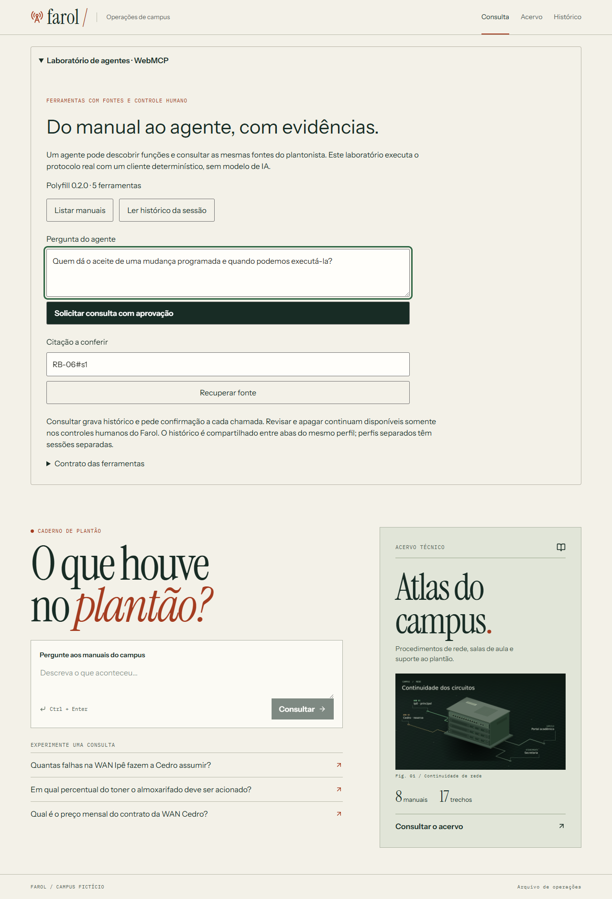
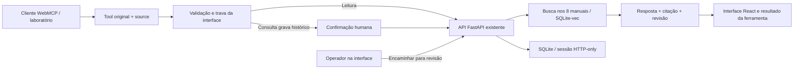

# Farol + WebMCP

**Uma aplicação de suporte que oferece funções verificáveis a agentes, preservando suas fontes e a decisão do operador.**

[Código do adaptador](../web/src/webmcp.ts) · [Testes de integração](../../tests/webmcp/farol.spec.mjs) · [Decisões e segurança](webmcp-security.md) · [Farol completo](../README.md)

<details>
<summary>Veja o laboratório funcionando — captura da execução testada</summary>



[Versão para celular](webmcp-390.png)
</details>

## O problema que esta atualização resolve

Um agente que só enxerga a tela precisa interpretar botões, localizar textos e reconstruir o contexto de uma consulta. Isso cria dependência do layout e dificulta conferir de onde veio uma orientação. Expor diretamente o banco ou uma credencial de serviço criaria outro problema: acesso além da sessão do operador.

O Farol passa a publicar cinco ferramentas com entradas explícitas no próprio navegador. O agente descobre as capacidades, solicita uma resposta e recupera a seção citada pela mesma API que atende a interface. A pergunta e a resposta aparecem no produto. A consulta só é enviada após confirmação, pois também grava histórico.

**Exemplo:** “Quem dá o aceite de uma mudança programada e quando podemos executá-la?” retorna a orientação com a fonte `RB-06#s1`. A ferramenta de fontes recupera o texto e a revisão para conferência. Uma pergunta sobre o preço do contrato WAN recebe recusa por falta de evidência; o operador decide se encaminha para revisão.

## O que este caso demonstra para uma equipe de engenharia

| Decisão | Problema atendido | Evidência no código |
| --- | --- | --- |
| Adaptador pequeno sobre a API existente | Evitar dois motores de busca e regras divergentes | `web/src/webmcp.ts` chama `/api/ask`, `/api/catalog` e `/api/runs` |
| Objeto `Tool` preservado | Evitar executar outro registro com o mesmo nome | Cliente retém o handle; teste de registro revogado |
| Contrato e validação em execução | JSON Schema sozinho não valida chamadas | Rejeição de campos extras, IDs, limites e caminhos inválidos |
| Cookie HTTP-only, sem argumento de sessão | Evitar que o agente escolha a identidade de outra pessoa | Teste com dois contextos reais de navegador |
| Aprovação por consulta e revisão fora das ferramentas | Impedir escrita automática pelo caminho WebMCP | Recusa deixa o histórico vazio e não envia POST |
| Busca extrativa e cliente determinístico | Tornar a demonstração repetível sem GPU, chave ou custo de modelo | Mesmo serviço e fontes sintéticas do Farol |

Não há medição de redução de custo, latência ou taxa de sucesso de agentes. O ganho demonstrado é uma interface programática testável que reutiliza as regras do produto.

## Arquitetura



As ferramentas só são registradas depois que a inicialização da interface estabelece a sessão. Operações da interface e das ferramentas compartilham uma trava por página. Não há fila de escritas nem repetição automática após falha. Abas do mesmo perfil compartilham a sessão; a proteção do servidor contra exclusão durante consultas continua valendo entre abas.

## Executar em cerca de cinco minutos

Pré-requisitos: **Python 3.12, Node 24 e um navegador Chromium**. Use localhost ou HTTPS. Não é necessário habilitar flags experimentais. O polyfill é carregado quando `document.modelContext` não existe. A instalação abaixo usa apenas dependências locais do projeto; `package-lock.json` fixa a árvore JavaScript.

Na raiz do repositório:

```sh
git switch feat/farol-webmcp
cd portfolio/farol
python -m venv .venv
```

Ative o ambiente:

```powershell
# Windows / PowerShell
.venv\Scripts\Activate.ps1
```

```sh
# Linux / macOS
. .venv/bin/activate
```

Depois, em qualquer um dos ambientes:

```sh
python -m pip install --only-binary=:all: -r service/requirements.txt
cd web
npm ci --ignore-scripts
npm run build
cd ../service
python -m uvicorn app:app --host 127.0.0.1 --port 8083
```

Abra [localhost:8083](http://localhost:8083). Em um terminal previamente usado com LLM ou automação, remova `LLM_MODEL` e `REVIEW_WEBHOOK_URL` para usar a demonstração local. Não configure credenciais. A consulta extrativa e a fila local funcionam sem o n8n.

## Roteiro para uma apresentação de três minutos

1. Abra **Laboratório de agentes · WebMCP**. O status informa o mecanismo utilizado e cinco ferramentas disponíveis.
2. Clique em **Listar manuais**. São oito manuais fictícios; o resultado vem da API real.
3. Use a pergunta já preenchida e clique em **Solicitar consulta com aprovação**. Primeiro recuse: nenhum POST de consulta deve ocorrer. Leia o histórico para conferir.
4. Repita e autorize. A resposta aparece no caderno e como JSON no laboratório. A citação esperada é `RB-06#s1`.
5. Clique em **Recuperar fonte** com essa citação. Compare o texto e a revisão com a resposta. A fonte não foi inventada pelo cliente.
6. Pergunte **Qual é o preço mensal do contrato da WAN Cedro?**. Autorize e observe a recusa por falta de evidência. **Encaminhar para revisão** é uma ação do operador na resposta, não uma ferramenta publicada.
7. Abra outro perfil ou janela anônima: o histórico anterior não aparece. Uma segunda aba do mesmo perfil compartilha o histórico, por definição.

O laboratório é um **cliente determinístico do protocolo**, não um LLM nem uma conexão já validada com Gemini, ChatGPT ou outro agente comercial. Não requer inferência na GPU.

## Contrato publicado

| Ferramenta | Entrada | Saída | Efeito |
| --- | --- | --- | --- |
| `farol_catalog` | `{}` | Manuais aprovados e seções | Leitura |
| `farol_source` | `{ "citation": "RB-06#s1" }` | Texto, título, seção e revisão | Leitura |
| `farol_history` | `{}` | Histórico da sessão atual | Leitura |
| `farol_run` | `{ "id": "..." }` | Consulta da sessão com evidências | Leitura; API retorna 404 para outra sessão |
| `farol_ask` | `{ "query": "...", "document": "RB-06" }` | Resposta ou recusa fundamentada; `document` é opcional | Confirmação antes de salvar |

Campos como `session`, `url` e `approved` são rejeitados. A confirmação não pode ser fornecida como argumento. Recusa humana retorna `{ "status": "cancelled", ... }`; falhas de execução rejeitam a promessa conforme o protocolo. Após falha de rede, consulte o histórico antes de repetir: cancelar a espera não garante desfazer uma gravação já concluída no servidor.

## Compatibilidade com a interface Tool

Alvo: **`@w3c/webmcp-polyfill@0.2.0` + `webmcp-types@0.2.0`**, no contrato disponível em 24/11/2026. O PR [webmcp#348](https://github.com/webmachinelearning/webmcp/pull/348) foi integrado em 19/11; a data do anúncio não é a data do merge.

- Descoberta em `document.modelContext.getTools()` e execução com `executeTool(tool, inputObject)`; o resultado é uma string JSON.
- O cliente verifica `tool.source === window`. Não usa o antigo membro `tool.window` nem identifica registros apenas pelo nome.
- `JSON.stringify(tool)` e spread não transportam os atributos da interface. `describeTool` lê os campos explicitamente para exibição, mantendo o objeto original para execução.
- `inputSchema` e `annotations` ausentes são tratados como `null`.
- O contrato nativo não permite `structuredClone(tool)`. O projeto nunca depende de clonagem. O polyfill não reproduz necessariamente todos os comportamentos internos de clonagem de uma interface nativa.
- Um `AbortController` controla o ciclo de vida de cada grupo de registros. Um registro revogado não volta a funcionar quando outro recebe o mesmo nome.
- Implementações nativas parciais não são sobrescritas. O laboratório informa indisponibilidade e o Farol convencional continua funcionando.

**Limite da validação:** a execução local foi com o polyfill real em Chromium, não com a implementação nativa do Chrome 160. Compatibilidade com o contrato é coberta por testes; integração nativa e agentes externos exigem uma rodada própria. WebMCP ainda é um rascunho de Community Group, não um padrão W3C final.

## Repetir os testes

Com o ambiente Python ativado, em `portfolio/farol/service`:

```sh
python -m unittest -q
cd ../../tests
npm ci --ignore-scripts
npx playwright install chromium
npx playwright test --config webmcp.config.mjs
```

O frontend deve ter sido compilado antes. O teste inicia a API real em `127.0.0.1:18083`, com banco temporário próprio, sem LLM e sem webhook. Não usa nem apaga o banco da demonstração. O servidor é encerrado pelo Playwright; os arquivos temporários ficam no diretório temporário do sistema. É possível escolher o interpretador com `FAROL_PYTHON` e um Chromium existente com `CHROMIUM_PATH`.

Relatório JSON e capturas de desktop/celular ficam em `portfolio/tests/test-results/`. O [workflow dedicado](../../../.github/workflows/farol-webmcp.yml) repete os testes no Linux e publica os artefatos. Os números de execução local estão em [validação](webmcp-validation.md).

## Referências verificadas

Consultadas em 24/11/2026: [Farol original](https://github.com/Victor-F-M-A-R/Curriculo/tree/c3cb7b52f4d2659d3b39b99e17d4b84d3949b4eb/portfolio/farol), [mudança da interface Tool](https://github.com/webmachinelearning/webmcp/pull/348), [rascunho WebMCP](https://webmachinelearning.github.io/webmcp/), [polyfill oficial e limites](https://github.com/w3c-oss/webmcp-polyfill), [metadados npm 0.2.0](https://registry.npmjs.org/@w3c%2fwebmcp-polyfill/0.2.0). A página HTML do npm retornou 403; o registro público e o repositório oficial foram acessíveis.
