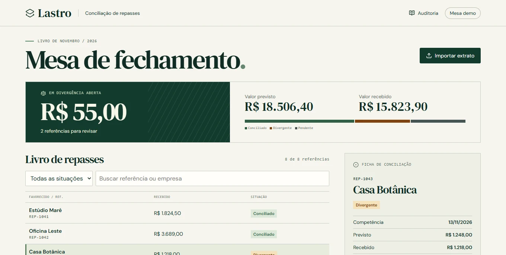

# Lastro

[Ver demonstração](../docs/demonstracoes.md#lastro) · [Todos os projetos](../../README.md)



O financeiro recebe títulos previstos e um extrato de repasses. O Lastro compara os valores por referência, separa as diferenças e mantém um livro de revisões. A tela abre diretamente em uma mesa com oito títulos fictícios. Uma conta registrada permite sair e recuperar sua própria mesa.

**Escopo do produto.** A pessoa que fecha os repasses precisa entender por que o recebido diverge do previsto e registrar sua decisão para consulta posterior. A mesa importa um CSV, reconcilia valores em centavos e guarda a justificativa em um evento separado. Os dados são sintéticos. O sistema não movimenta dinheiro nem se conecta a uma instituição financeira.

## Demonstrar

1. Abra [a mesa](http://localhost:8082) após iniciar o [Compose](../README.md).
2. Clique em **Importar extrato → Usar extrato de exemplo → Conciliar lote**. O arquivo também está em [samples/repasses.csv](samples/repasses.csv).
3. Importe o mesmo lote outra vez. Abra REP-1048, confira os R$ 17,50 de diferença e registre a justificativa.
4. Na ficha, abra **Abrir trilha de auditoria**. A tela Blazor exibe a justificativa de REP-1048 com data em UTC e ID do evento. Use o filtro **Tipo de evento** ou clique em **Limpar filtros** para ver as demais atividades da mesa.
5. No celular, selecione a linha de um repasse e acompanhe o foco até o título da ficha. **Voltar ao repasse selecionado** retorna à linha original. Ao filtrar, o foco permanece no filtro e a primeira referência disponível assume a seleção se a anterior desaparecer. Limpar o filtro conserva essa seleção. Se uma revisão remove a ficha do filtro, o foco retorna à próxima linha ou ao filtro vazio. Um anúncio informa a seleção e a quantidade de resultados.

## O que acontece no servidor

O parser valida o arquivo inteiro, interpreta vírgula decimal e converte os valores para centavos inteiros. A referência e a impressão digital do lote têm unicidade por mesa. O banco grava o lote, seus repasses e o evento em uma transação. Se a última linha conflitar, o banco reverte o lote inteiro.

`Book.cs` oferece SQLite em arquivo, PostgreSQL e SQL Server usando Dapper. A operação de revisão aceita divergências abertas e repasses sem título. O histórico registra a justificativa sem modificar o recebimento. O cookie de sessão assinado inclui o identificador da mesa. A API usa esse identificador para todas as consultas. Cadastro e login usam o PasswordHasher do ASP.NET, limite de tentativas e cookies HTTP-only.

A consulta SQL da revisão localiza a referência pela chave da mesa. A auditoria em Blazor usa renderização no servidor e filtros HTML por tipo e referência. Cada página traz até 20 eventos em ordem decrescente. O cursor combina data e ID e mantém a ordem quando dois eventos compartilham o instante. Um índice composto por mesa, data e ID atende à paginação. O filtro usa parâmetros Dapper e recebe a mesa exclusivamente da sessão.

| Rota | Uso |
| --- | --- |
| `GET /api/session` | Identidade atual e `workspace` opaco da mesa, ou `null` sem sessão |
| `POST /api/session/demo` | Abrir uma mesa com dados sintéticos |
| `POST /api/register`, `/api/login`, `/api/logout` | Criar conta, entrar e sair |
| `GET /api/book`, `GET /api/book/events` | Ler lançamentos e eventos da mesa autenticada |
| `POST /api/book/import` | Enviar `{"csv":"..."}` com até 500 linhas |
| `POST /api/book/{referencia}/review` | Enviar `{"note":"..."}` para uma divergência |
| `GET /audit?tipo=review&referencia=REP-1048` | Auditoria Blazor com filtros opcionais e paginação por cursor |

Os POSTs da aplicação exigem o cabeçalho `X-Lastro-Client: desk`. A política de mesma origem do navegador e o cookie SameSite Strict fazem parte do desenho. Uma mesa anônima dura a sessão do navegador. Uma conta nova recebe um lote próprio.

Os POSTs de `/api/book` também exigem **`X-Lastro-Workspace`**, com o valor retornado por `/api/session`. Esse identificador não concede acesso: o servidor continua usando a mesa do cookie e compara o contexto esperado antes de gravar. Sem o cabeçalho, clientes antigos recebem **428** (`workspace_required`); se outra aba trocou a conta, recebem **409** (`workspace_changed`). A interface esvazia os dados antigos, atualiza a identidade e oferece **Carregar mesa atual**, sem reenviar a alteração. Leituras que enviam o contexto também rejeitam divergência; leituras sem ele continuam limitadas à mesa autenticada. Não há cliente mutante dispensado dessa verificação.

A espera por conexão e por comando de banco é limitada a cinco segundos. Indisponibilidade retorna HTTP 503 com uma mensagem para conferir o estado antes de repetir uma alteração. O navegador também distingue confirmação perdida de uma rejeição recebida: uma interrupção da rede pode ocorrer depois da gravação. Lotes idênticos convergem para uma importação; outra justificativa sobre um repasse já revisado recebe conflito. Ao detectar sessão expirada, a tela esvazia a mesa anterior e oferece entrada na conta ou uma nova demonstração explícita.

## Desenvolvimento e testes

Instale .NET 10 e Node 24. Execute estes comandos em dois terminais.

```sh
dotnet run --project server --urls http://127.0.0.1:8082
```

```sh
cd web
npm ci
npm run dev
```

Abra o endereço indicado pelo Vite. Rode `dotnet test tests -c Release` na pasta Lastro. A suíte cobre replay, importações e revisões concorrentes, rollback de lote conflitante, trava de banco e recuperação, reabertura persistente, dinheiro e datas independentes da cultura, BOM/CRLF, limites de linhas e UTF-8, além da paginação com novos eventos. Em `web/`, `npm test` mede o contraste do texto nas cinco situações da interface a partir das cores do CSS. Esse teste também roda antes do build. Os [cenários no navegador](../tests/specs/lastro-robustness.spec.mjs) exercitam autenticação e isolamento, seleção e foco, sessão expirada, reflow em 320 CSS pixels e auditoria. Verificar papéis e anúncios automaticamente não substitui uma sessão manual com leitor de tela.

Para conectar SQL Server, configure `BOOK_ENGINE=sqlserver` e `BOOK_CONNECTION` com uma base vazia dedicada. PostgreSQL usa `BOOK_ENGINE=postgres`. Em PostgreSQL gerenciado ou Aurora, configure TLS, credencial e conectividade privada do ambiente. Os testes aceitam `TEST_BOOK_ENGINE` e `TEST_BOOK_CONNECTION` para uma base descartável.

## Projeção de auditoria em Cosmos DB

Ao definir `COSMOS_CONNECTION`, o serviço de fundo lê o outbox e envia até 50 eventos por iteração ao contêiner existente. Use `COSMOS_DATABASE` (padrão `lastro`), `COSMOS_CONTAINER` (padrão `audit`) e partição `/workspace`. O ID do documento é o ID imutável do evento. Uma repetição entre o upsert e a marca de exportação converge para o mesmo documento.

Os testes locais rodaram com SQLite e PostgreSQL. O caminho SQL Server e o projetor Cosmos foram compilados. A conexão a uma instância real de cada um está identificada na [matriz de evidências](../docs/verificacao.md).
