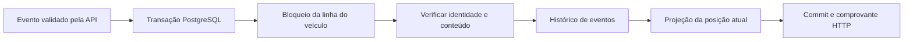

# Rastro

### A última mensagem recebida nem sempre é a posição mais recente.

Um dispositivo perde a conexão e envia posições acumuladas quando a rede volta. O monitor precisa guardar essas leituras sem mover o veículo para trás no tempo. Se o mesmo evento chegar de novo, os totais também precisam permanecer corretos.

O Rastro demonstra esse fluxo com **PostgreSQL, SQL transacional, FastAPI e uma interface JavaScript**. A frota e as coordenadas são sintéticas. O trajeto desenhado é uma representação dos pontos registrados, sem mapa externo ou rastreamento de pessoas.

[Assistir à demonstração](../docs/demonstracoes.md#rastro) · [Ver função SQL](sql/001_telemetry.sql) · [Testes do banco](tests/test_rastro.py) · [Contrato HTTP](tests/test_http.py)

## Experimente

Na pasta `portfolio/`, com Docker Compose v2 disponível:

```sh
docker compose up --build -d postgres rastro
```

Abra [localhost:8084](http://localhost:8084). Selecione **Cedro · TRK-018** e clique em **Simular chegada**.

1. A sequência 5 atualiza a posição para 09:24, no horário de Brasília.
2. O reenvio da mesma sequência é reconhecido sem criar outra posição.
3. A sequência 4, observada às 09:18, entra no histórico com a marca **Atrasada**. A posição atual continua em 09:24.
4. Ao repetir a simulação, o comprovante mostra **3 reenvios**. A frota continua com 11 posições únicas e uma leitura atrasada, no cenário inicial.

O conjunto usa o turno fixo de **18/11/2026**; a tela apresenta data e hora da última leitura. Reiniciar o serviço preserva os dados. Se a simulação já tiver sido executada, os três reenvios na primeira tentativa são esperados. Não é necessário apagar o banco para usar o monitor.

`docker compose stop rastro` encerra o aplicativo e conserva o volume do PostgreSQL, que também é utilizado pelos outros projetos.

## O que acontece no banco



| Objeto | Responsabilidade |
| --- | --- |
| `rastro.vehicles` | Cadastro da frota e linha bloqueada durante a ingestão daquele veículo. |
| `rastro.telemetry_events` | Histórico persistente com horário observado, horário recebido, sequência e indicação de chegada atrasada. |
| `rastro.vehicle_state` | Referência ao evento atual, total de eventos únicos e total de chegadas atrasadas. |
| `rastro.ingest` | Classificação do evento e alteração do histórico e da projeção na mesma transação. |

A identidade idempotente é o par **veículo + UUID do evento**. Um UUID repetido com os mesmos valores retorna `replay`; com conteúdo diferente, retorna `conflict`. Outro UUID que tente ocupar o mesmo **veículo + horário observado + sequência** também é rejeitado. A sequência pode se repetir em outro instante: ela desempata eventos com o mesmo horário, e não é um contador global.

A posição atual é o maior par `(observed_at, device_seq)`, não o último horário de recebimento. Eventos anteriores permanecem consultáveis no histórico. `SELECT ... FOR UPDATE` serializa escritores do mesmo veículo; veículos diferentes têm linhas de bloqueio independentes. Os testes abrem conexões concorrentes reais, incluindo dois envios do mesmo evento e duas posições distintas.

Um reset da sequência para zero não faz a posição recuar quando o horário observado é mais recente. Se o relógio também recuar, a leitura permanece atrasada: o sistema não inventa uma ordem nova para compensar um dispositivo mal configurado.

As conexões da API limitam a espera por bloqueio a 2 segundos e a execução de cada comando a 8 segundos. O pool possui até 6 conexões e espera até 5 segundos por uma vaga. Se o banco estiver indisponível ou o limite for atingido, a API retorna 503; a transação é revertida e o cliente pode reenviar o mesmo evento com o mesmo UUID. O monitor limita a espera de rede a 15 segundos e oferece nova tentativa.

O pool verifica a conexão antes de entregá-la ao pedido HTTP e substitui conexões encerradas. Os limites de comando e bloqueio são executados pelo PostgreSQL; não são uma promessa de prazo total contra qualquer falha de rede. A indisponibilidade medida nesta rodada foi o servidor PostgreSQL encerrado, não uma conexão TCP mantida aberta indefinidamente sem resposta.

## API e configuração

| Recurso | Comportamento |
| --- | --- |
| `GET /health` | Verifica uma consulta real ao PostgreSQL. |
| `GET /api/fleet` | Lista veículos, posição atual e contadores. |
| `GET /api/vehicles/{id}/events?limit=20&cursor=…` | Histórico mais recente primeiro; aceita de 1 a 100 registros e devolve `next_cursor`. |
| `POST /api/events` | Ingestão protegida por `Authorization: Bearer …`. |
| `POST /api/demo/scenario` | Cenário fixo, disponível somente com `RASTRO_DEMO=1`; exige o cabeçalho do monitor. |

| Resposta de ingestão | Significado |
| --- | --- |
| `201 advanced` | Novo evento que avançou a posição. |
| `201 late` | Novo evento atrasado, conservado sem alterar a posição atual. |
| `200 replay` | Mesmo evento e mesmos valores, sem nova escrita. |
| `409` | Identidade ou posição temporal conflitante. |
| `401` | Credencial ausente ou inválida quando a ingestão está habilitada. |
| `404` | Veículo não cadastrado. |
| `422` | Dados inválidos, horário sem fuso ou relógio mais de cinco minutos no futuro. |
| `503` | Ingestão desativada, banco indisponível ou limite de espera atingido. |

Um evento tem os campos abaixo. O cadastro do veículo precisa existir antes da ingestão.

```json
{
  "vehicle_id": "TRK-018",
  "event_id": "27580e15-39dc-4ca4-aad8-98ed1b60c5b8",
  "observed_at": "2026-11-18T09:30:00-03:00",
  "device_seq": 6,
  "latitude": -23.492100,
  "longitude": -46.541300,
  "speed_kmh": 41
}
```

`RASTRO_DATABASE_URL` recebe a conexão PostgreSQL. `RASTRO_DEMO=1` cria o pequeno cadastro sintético e habilita a simulação; a carga inicial é idempotente. `RASTRO_INGEST_TOKEN` habilita a ingestão externa. Sem essa variável, a ingestão responde 503 e o monitor continua funcionando. A credencial não é incluída no JavaScript nem exibida na página.

A API valida UUID, data/hora ISO 8601 com `T` e fuso explícito, limites de latitude/longitude, até seis casas decimais, velocidade de 0 a 220 km/h e sequência inteira não negativa. Booleanos, strings e números fracionários não são convertidos silenciosamente em sequência ou velocidade. Campos extras e números não finitos são rejeitados com 422, sem ecoar o conteúdo recebido. Consultas utilizam parâmetros SQL; o monitor insere texto com `textContent`. Cabeçalhos restringem scripts e conexões à própria origem e impedem enquadramento por outra página.

A tolerância de relógio é **até cinco minutos no futuro**, inclusive a fronteira exata, para permitir pequenas diferenças de dispositivo. Além disso, o pedido é rejeitado antes de gravar. Uma leitura dentro dessa tolerância pode ser a posição corrente; leituras anteriores continuam no histórico, sem exclusão ou alteração arbitrária. O teste congela o relógio para verificar +5 minutos e +5 minutos +1 microssegundo.

### Percorrer o histórico

Copie `next_cursor` para o próximo pedido; `null` indica o fim. O cursor é uma posição de leitura vinculada ao veículo, não uma credencial. Valores inválidos ou usados em outro veículo recebem 422. A consulta usa a chave `(observed_at, device_seq)`, com o mesmo índice do histórico, em vez de deslocamentos por número de linha.

A paginação é uma **visão viva**: uma posição recém-chegada acima da fronteira aparece após **Atualizar**; uma leitura atrasada abaixo dela pode entrar nas páginas seguintes. As posições já percorridas não se repetem. Não há promessa de um snapshot congelado entre pedidos HTTP. No monitor, **Carregar posições anteriores** preserva os registros visíveis após uma falha e permite tentar novamente; ao atingir o fim pelo teclado, o foco retorna ao título do histórico.

## Executar e testar com Python

Use **Python 3.12** em um ambiente virtual e um PostgreSQL dedicado aos testes. O banco precisa existir; o aplicativo aplica a migração versionada e serializa inicializações concorrentes com um bloqueio transacional. Para executar no Windows, a partir de `portfolio/rastro/`:

```powershell
py -3.12 -m venv .venv
.venv\Scripts\python -m pip install -r requirements.txt
$env:RASTRO_DATABASE_URL = 'host=127.0.0.1 dbname=rastro_test user=rastro'
# Configure a autenticação do PostgreSQL no seu ambiente local.
.venv\Scripts\python -m unittest discover -s tests -v
$env:RASTRO_DEMO = '1'
.venv\Scripts\python -m uvicorn app:app --host 127.0.0.1 --port 8084
```

Em Linux/macOS, o equivalente utiliza `python3 -m venv .venv`, `.venv/bin/python` e `export RASTRO_DATABASE_URL='…'`. Não aponte a suíte para dados de produção: os testes criam registros sintéticos e removem apenas os veículos que criaram.

Os testes verificam persistência, ordenação temporal, desempate por sequência, reenvio, conflito, concorrência, rollback de um lote, repetição do cenário, contrato HTTP, autenticação, limites de consulta e recuperação após bloqueio. [Evidências gerais e execução contínua](../docs/verificacao.md) registram o que foi efetivamente executado. O teste de navegador está em [rastro.spec.mjs](../tests/specs/rastro.spec.mjs).

### Rodada de 20/11/2026

| Ensaio executado | Resultado |
| --- | --- |
| Python 3.12 + PostgreSQL 17, banco exclusivo | **26 testes aprovados**, incluindo conflitos concorrentes, números inválidos, autenticação, relógio, cursor e conexão encerrada. |
| 30 posições em 3 envios embaralhados, UTC e UTC-3 | 30 posições únicas, 60 reenvios e sequência 30 preservada como posição atual. |
| Chrome, um trabalhador, interface real | **6 cenários aprovados**, incluindo 320 px, teclado, resposta de outro veículo chegando tarde, paginação, falha e nova tentativa. Atrasos e erros específicos são injetados pelo teste; a API e o PostgreSQL reais atendem os demais fluxos. |
| Reinício completo do PostgreSQL em volume exclusivo e depois reinício da API | Os mesmos 3 veículos, 11 eventos e posições atuais permaneceram; repetir o cenário retornou 3 reenvios. |
| PostgreSQL encerrado, depois iniciado novamente | A consulta retornou 503 em aproximadamente 5 segundos; a retomada recuperou o mesmo estado. |

O ensaio de reinício usou um volume persistente novo, não `tmpfs`. Os ambientes foram limitados a 0,5 CPU por serviço, com 256 MiB para o PostgreSQL e 512 MiB para a API. Esses resultados verificam os cenários descritos; não medem capacidade de produção, latência sob carga ou garantia de disponibilidade.

## Consulta e índice

O índice `telemetry_vehicle_order` começa por veículo, segue a mesma ordenação da consulta de histórico e inclui as colunas projetadas. O script [sql/explain.sql](sql/explain.sql) compara a mesma consulta antes e depois do índice, em uma tabela temporária de 60.000 eventos. Ele termina com `ROLLBACK` e não altera a frota.

```powershell
psql $env:RASTRO_DATABASE_URL -X -v ON_ERROR_STOP=1 -f sql/explain.sql
```

[A captura anterior em PostgreSQL 16.2](evidence/explain-pg16.txt) registra a troca de varredura sequencial com ordenação por acesso ao índice. É uma medição local sobre dados sintéticos, sujeita a cache, equipamento e distribuição dos dados; não representa capacidade de produção nem um ganho garantido.

## Fronteiras da demonstração

O Compose publica somente em `127.0.0.1`. O monitor é de leitura pública dentro dessa demonstração local; não há contas, autorização por empresa, mapa de ruas ou rastreadores físicos. O cabeçalho da simulação reduz chamadas acidentais de outras origens, mas não é autenticação. Para dados reais ou acesso remoto, seriam necessários autenticação de leitores, autorização, gestão de dispositivos/credenciais, TLS, política de retenção e operação de backups. A API atual não promete esses recursos.

A API recebe um evento por transação; não existe endpoint externo de lote. O cenário de demonstração também opera um único veículo. Quem chamar a função SQL para vários veículos na mesma transação deve bloquear as linhas em ordem consistente e decidir pelo rollback se receber `conflict`: esse agrupamento externo não ganha atomicidade de negócio automaticamente. Os testes de rollback existentes comprovam a reversão diante de erro SQL, não um importador de lotes que o produto não oferece.

Implementação assistida por IA, criada para explicar decisões e permitir reprodução dos testes. Referências: [limites de comandos e bloqueios no PostgreSQL](https://www.postgresql.org/docs/17/runtime-config-client.html) e [transações e conexões do pool Psycopg](https://www.psycopg.org/psycopg3/docs/advanced/pool.html).
